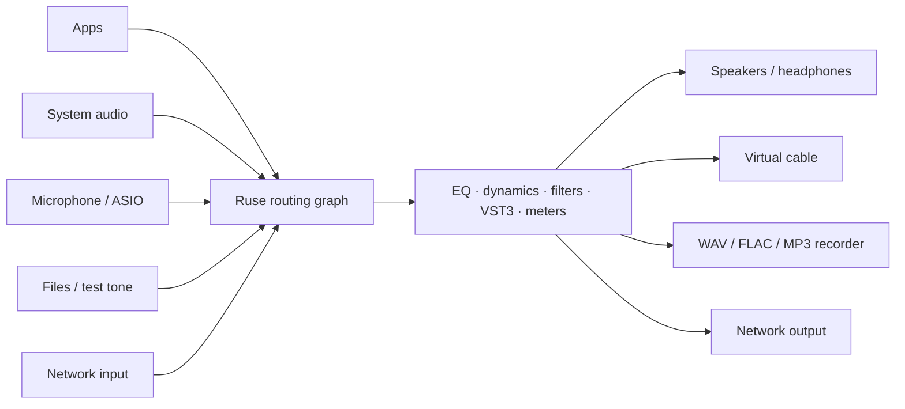

# Ruse — Windows Audio Router

**Send audio anywhere on Windows.** Ruse is a free, open-source audio router with a visual node graph. Capture audio from apps, the whole PC, microphones or ASIO interfaces, shape it with effects, and send it to speakers, headphones, virtual cables, another PC or a recorder.

[Download for Windows](https://github.com/fer-RR/ruse/releases/latest) · [Features](#features) · [Quick start](#quick-start) · [Common setups](#common-setups) · [Build from source](#build-from-source)

[](https://github.com/fer-RR/ruse/releases/latest)
[](LICENSE)
[](#requirements)

Ruse is a desktop audio router for Windows 10 and 11. It gives you one place to capture, process, monitor, record and forward sound. Instead of stacking several utilities, you build a routing graph: drag a source and a destination onto the canvas, connect them with a cable, and add effects in between.

It is **not** a DAW, and it does **not** install a kernel driver. It works with the audio devices you already have, including virtual cables such as VB-CABLE and Voicemeeter.

Audio is processed locally. Ruse does not upload your audio. Optional transcription, translation and text-to-speech models run on your machine after download.

## What you can do with Ruse

- **Send one app to two devices.** Hear game audio in headphones while sending a copy to a virtual cable for streaming.
- **Keep voice and game audio separate.** Route Discord, a game, a microphone and music to different devices with independent levels.
- **Clean up a microphone.** Add high-pass, EQ, compression, noise reduction, de-esser, gate and limiter before the mic reaches Discord, OBS or a call.
- **Build a monitor mix.** Use the mixer, sends, sidechain ducker and native-safe processors for a small live or streaming setup.
- **Record the final mix.** Record WAV, FLAC or MP3 from any route, or render a timeline mix offline.
- **Send audio to another PC.** Use Ruse-to-Ruse UDP audio over your local network.
- **Process with VST3.** Host VST3 effects in an isolated process so a plugin crash does not take down the whole app.
- **Analyze the signal.** View spectrum, spectrogram, waveform, dB, loudness and true-peak meters.
- **Automate the graph.** Use the optional local HTTP/WebSocket control API, MIDI learn and keyboard shortcuts.

## Features

### Routing

- Per-app audio capture, system loopback, microphones, line inputs and ASIO inputs.
- WASAPI and ASIO outputs (ASIO is experimental).
- Existing virtual cables and virtual buses.
- File playback, test-tone generator, network input and network output.
- Direct source-to-device routes and **native passthrough** without sample-rate conversion.
- Sidechain inputs, per-send gain, mute/solo and a full mixer.

### Processing

- **61 built-in effects**, including EQ, filters, dynamics, gates, saturation, pitch, auto-tune, vocoder, delays, reverbs, convolution and character effects.
- VST3 hosting in an isolated child process.
- Effect chains, saved chains, frame templates and per-effect bypass.
- Timeline tracks, clips, fades, gain, automation and offline bounce/freeze.

### Output and recording

- Speakers, headphones, ASIO devices and virtual cables.
- WAV (16/24-bit, 32-bit float), FLAC and MP3 recording.
- Timeline bounce and freeze with effect-chain rendering.
- Ruse-to-Ruse UDP audio for a trusted local network.
- SHA-256 verified release packages and an optional in-app updater.

### Extras

- Optional local Whisper transcription, translation and text-to-speech.
- Local control API for scripts and automation, off by default.
- Ten UI themes, including a Windows light/dark follow mode.
- Keyboard shortcuts, reduced-motion support and screen-reader labels.
- English, German, Spanish, French, Italian, Japanese, Korean, Portuguese (Brazil) and Chinese (Simplified) UI.

## How it works



Each node is a source, processor or destination. Cables carry audio. You can insert effects directly on a cable, create sidechain routes, and save a chain or frame as a template.

## Download and install

1. Open the [latest release](https://github.com/fer-RR/ruse/releases/latest).
2. Download `Ruse-<version>-win-x64.zip`.
3. Extract the ZIP and run `Ruse.exe`.
4. Optionally verify the download with the published `.sha256` file.

The package is self-contained and includes the .NET runtime. It does not include VST3 plugins, ASIO drivers or speech/translation model files.

## Requirements

- **OS:** Windows 10 or 11, x64.
- **Per-app capture:** Windows 11 or Windows Server 2022.
- **Runtime:** Microsoft Edge WebView2 Runtime. Windows 11 includes it; most Windows 10 devices have it, and Ruse links to the installer if it is missing.
- **Build tools:** .NET 10 SDK and Node.js 20 or newer.
- **Network audio:** Ruse-to-Ruse UDP PCM on the same trusted LAN. It is not encrypted.
- **Models and drivers:** Whisper, translation, TTS, VST3 plugins and ASIO drivers are installed separately.

## Quick start

1. **Add a source.** Drag an app, system audio, microphone, ASIO input, file, tone or network input from the Library onto the canvas.
2. **Add a destination.** Drag speakers, headphones, a virtual cable, a recorder or a network output onto the canvas.
3. **Connect them.** Drag from the source's **OUT** port to the destination's **IN** port.
4. **Add processing (optional).** Drag an effect onto the cable or between two nodes.
5. **Start routing.** Press the power button in the toolbar. Open the **Mixer** to adjust levels and the **Timeline** for clips and automation.

The first-run tour and the `?` help buttons explain the main workflows.

## Common setups

| Goal | Suggested route |
| --- | --- |
| Hear a game and send it to Discord | Game app → High-pass/EQ → Headphones and VB-CABLE |
| Use a microphone in Discord and OBS | Microphone → High-pass → Compressor → Limiter → VB-CABLE |
| Record a stream mix | Apps + microphone → Mixer → File recorder |
| Send audio to a second PC | Source → Network output; Network input → speakers on the other PC |
| Keep music out of a call | Music app → Headphones only; microphone → call output |
| Add a VST3 effect | Source → VST3 node → destination; open the plugin editor in the node |

## Build from source

```powershell
dotnet build src\Ruse.App\Ruse.App.csproj
```

Output: `src\Ruse.App\bin\Debug\net10.0-windows\Ruse.exe`

The build also compiles the React UI in `src\Ruse.App\WebUi`.

## Test

```powershell
powershell -ExecutionPolicy Bypass -File scripts\regress-ruse.ps1 -Build
```

Individual checks: `Ruse.exe --effects-test`, `--dsp-test`, `--web-test`, `--selftest`.

## Package a release

```powershell
powershell -ExecutionPolicy Bypass -File scripts\package-ruse.ps1
```

This writes `Ruse-<version>-win-x64.zip` and its SHA-256 file to the package folder.

## Documentation

- [Backlog](docs/BACKLOG.md)
- [Control API](docs/CONTROL-API.md)
- [Third-party notices](THIRD-PARTY-NOTICES.md)

## Contributing

Issues and pull requests are welcome. Before opening a PR, run the regression script above and describe the audio device, driver and Windows version used for testing. Real-device results are especially useful for WASAPI, ASIO, VST3 and low-latency work.

## License

MIT. See [LICENSE](LICENSE) and [THIRD-PARTY-NOTICES.md](THIRD-PARTY-NOTICES.md).
