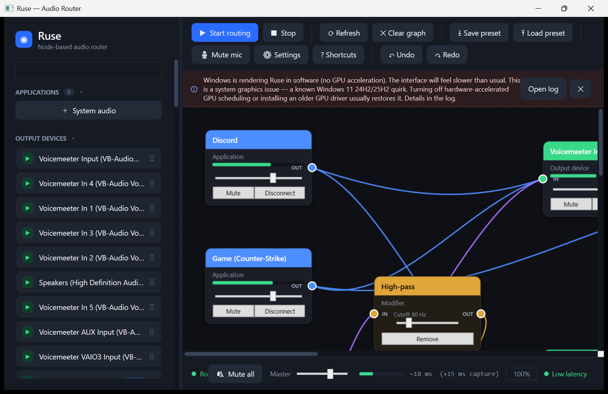

# Ruse

A node-based audio router for Windows. Route any application, system sound or
capture device to any output device, with an effect chain in between.



## What it does

- **Per-application capture** — pick a process (Edge, Discord, a game…) in the
  sidebar and drag it onto the canvas. Ruse captures it through the Windows
  process-loopback API, so nothing has to be reconfigured in the app.
- **Any output device** — WASAPI endpoints (speakers, headphones, Voicemeeter
  inputs) and **ASIO** drivers, including multichannel interfaces.
- **Effect chains** — 28 built-in effects (gain, EQ shapes, compressor, limiter,
  gate, reverb, delay, chorus, flanger, phaser, tremolo, pitch shift,
  bitcrusher, noise suppression, AGC, comfort noise…) with live parameters.
- **Saved chains** — build a chain of effects once, save it to the library and
  drop it anywhere as a single node.
- **Presets** — the whole graph (nodes, cables, effect settings) saves to a
  `.ruse.json` file.
- **Undo/redo** for everything, including node moves and effect tweaks.
- **Low latency** — the whole path is about 20 ms on a modern machine.
- **Diagnostics** — a built-in self-test suite (`--selftest` and friends) that
  exercises the audio engine without any hardware.

## Building

```bat
dotnet build src\Ruse.App\Ruse.App.csproj
```

Needs the .NET 10 SDK. The app itself is `src\Ruse.App\bin\Debug\net10.0-windows\Ruse.exe`.

## Running

| Flag | What it does |
|---|---|
| *(none)* | The normal window |
| `--demo` | A pre-built graph, handy for screenshots |
| `--live-demo --pid <pid>` | A graph wired to a running process |
| `--selftest` | The full self-test suite (writes `selftest.txt`) |
| `--route-test --pid <pid>` | Captures a real process and reports the signal |
| `--delay-test --pid <pid>` | Measures the delay from the app's tap to the speakers |
| `--latency-test --pid <pid>` | Reports the capture backlog and drift over time |
| `--device-test --pid <pid>` | End-to-end run against a real output device |
| `--perf-test --pid <pid>` | CPU and allocation profile of the whole app |
| `--effects-test` | Checks every effect: parameters, output, preset round-trip |
| `--sessions` | Lists the audio sessions and the process that owns each |

## How it is put together

```
src/Ruse.App/
  Audio/          the engine
    AudioGraph.cs         owns sources, modifiers and outputs
    SourceNode.cs         a capture source (app, device, system, ASIO)
    OutputNode.cs         a render endpoint (WASAPI or ASIO)
    ModifierNode.cs       an effect chain on a route
    Audio/                effect processors and the preset model
  Ui/             small dialogs and view models
  MainWindow*.cs  the window, split by area (one file per feature)
  Diagnostics/    the log
```

The engine always mixes at **48 kHz, stereo, 32-bit float**. Sources are
converted into that format, effects run in it, and outputs convert out of it —
WASAPI lets Windows do the conversion, ASIO drivers are resampled by Ruse when
the driver runs at another rate.

## Licences

NAudio is MIT licensed and ships the whole effect suite and the WASAPI/ASIO
layers. Ruse itself is a separate work.
